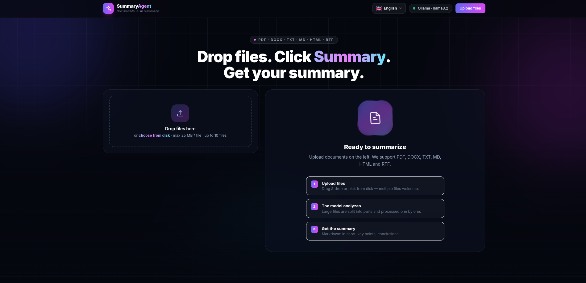
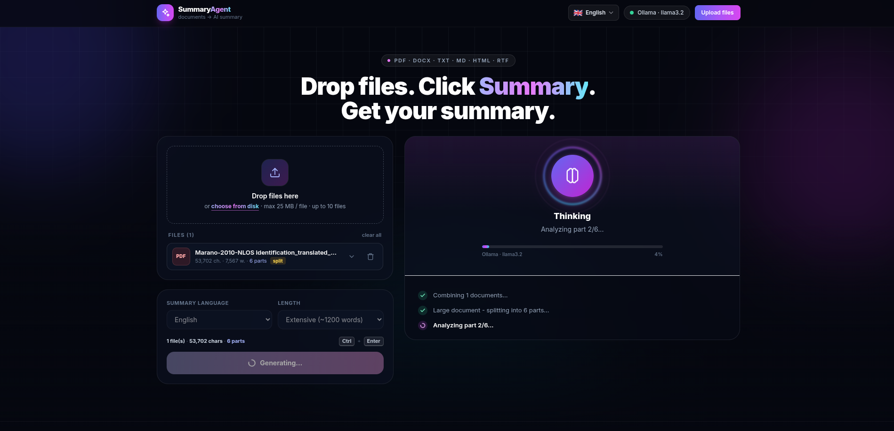
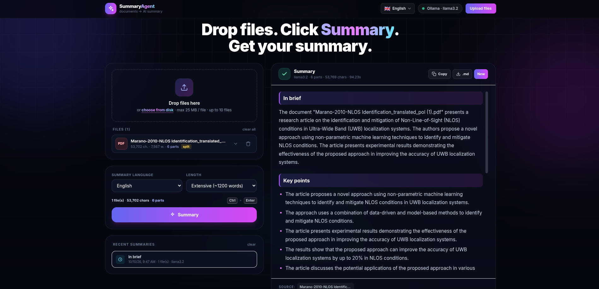
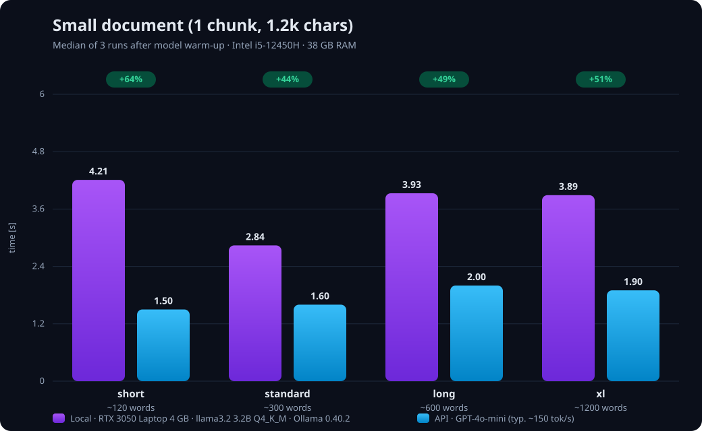
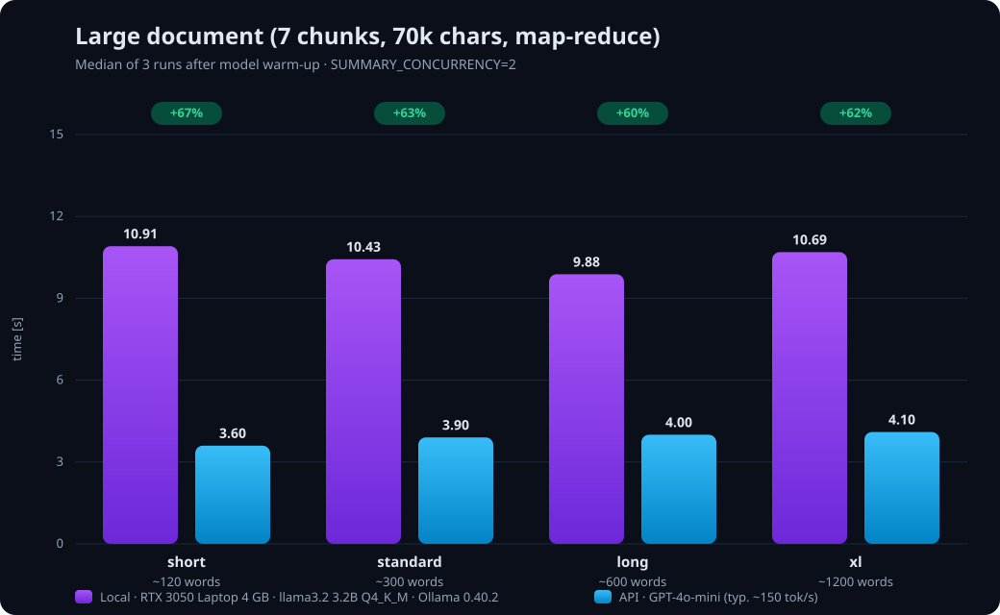

# SummaryAgent

Drop files (PDF, DOCX, TXT, MD, HTML, RTF) → click **Summary** → get a clean Markdown digest.

- **Local LLM or any OpenAI-compatible API** — leave `LLM_API_URL` empty and the app automatically falls back to local Ollama; point it at OpenAI, Groq, OpenRouter, DeepSeek, … and it uses that instead.
- **Large files are split automatically** (map-reduce): chunks are summarized in parallel and then combined into one coherent summary.
- **Live progress over SSE** — animated *Thinking* state, a per-part progress bar and a step-by-step event log while the model works.
- **Two independent languages** — the UI language (Polish/English, switcher in the header) is separate from the *summary language* (the select above the Summary button). Progress messages and history follow the interface; the digest itself — and its section headings — follow the summary language.
- **Markdown output** with *Copy* / *Download .md*, length presets (short → extensive) and a recent-summaries history stored in your browser.

| Upload | Generating | Result |
|---|---|---|
|  |  |  |

---

## Quick start (Docker — recommended)

```bash
cp .env.example .env        # empty LLM_API_URL => Ollama is used
docker compose up -d --build
```

On the very first start the `ollama` service pulls the default model (`llama3.2`, ~2 GB).

Open **http://localhost:8000**

> **GPU:** Ollama starts with NVIDIA GPU support by default (the `deploy` section in `docker-compose.yml`).
> On a machine without an NVIDIA card, delete that block.

> API only, no local model? `docker compose up -d --build api --no-deps`

### Use your own OpenAI-compatible API instead of Ollama

Put this in `.env`:

```bash
LLM_API_URL=https://api.openai.com/v1
LLM_API_KEY=sk-...
LLM_MODEL=gpt-4o-mini
```

then run just the backend: `docker compose up -d --build api --no-deps`

---

## Run without Docker

```bash
cp .env.example .env
uv sync --all-groups       # dependencies + dev tools (pytest, ruff)
uv run uvicorn backend.api.main:app --reload --port 8000
```

Ollama must then run locally (`ollama serve`, port `11434`) — set `OLLAMA_BASE_URL` in `.env` and pull the model: `ollama pull llama3.2`.

### Tests & lint

```bash
uv run pytest              # 135 tests: unit, integration (fake LLM), Playwright E2E
uv run ruff check backend tests
```

---

## Performance

Measured on this machine: **Intel i5-12450H, 38 GB RAM, NVIDIA RTX 3050 Laptop (4 GB)**,
Ollama 0.40.2 running **llama3.2 3.2B (Q4_K_M, 131k context)**. Local figures are the
median of 3 runs after the model was warm (the very first summary pays a one-off model
load into VRAM). The API series is **GPT-4o-mini** at a typical ~150 tok/s output.
Green badges show how much faster the API is vs. local.





Takeaways:

- **Small (single-chunk) documents** finish in **~3–4 s locally**; an API drops that to ~1.5–2 s (**+44–64%**).
- **Large (70k chars → 7 chunks, map-reduce)** takes **~10–11 s locally** end-to-end (both the parallel part analysis and the final combine); the API does it in ~4 s (**+60–67%**).
- Length preset barely matters locally — most of the wall time is prompt processing of the input, not generating the output.
- Local mode is fully offline and free; API mode is faster and scales past the 4 GB VRAM limit.

---

## Supported formats

| Extension | Format |
|---|---|
| `.pdf` | PDF (must have a text layer — not a scan) |
| `.docx` | Word (paragraphs + tables) |
| `.txt` | plain text |
| `.md`, `.markdown` | Markdown |
| `.html`, `.htm` | HTML |
| `.rtf` | RTF |

Adding a format is one entry in the registry (`backend/adapters/extractors`):

```python
from backend.adapters.extractors import register
register(".odt", "ODT", my_extractor)  # extractor: Callable[[bytes], str]
```

---

## API

| Method | Endpoint | Description |
|---|---|---|
| `GET` | `/api/health` | active provider (API / Ollama), model, formats |
| `POST` | `/api/documents` | upload files (`multipart`, field `files`) → text extraction |
| `DELETE` | `/api/documents/{id}` | delete a document |
| `GET` | `/api/summary/stream` | SSE stream: `status` → `done` / `error` |
| `GET` | `/api/ollama/status` | is Ollama up and is the model pulled |
| `GET` | `/docs` | Swagger documentation |

Every response carries an `X-Request-ID` header (echoed from the request or generated) — handy for log correlation.

Example stream call:

```
GET /api/summary/stream?doc_ids=abc123,def456&lang=pl&length=standard&ui_lang=en
```

| Param | Meaning |
|---|---|
| `lang` | language of the **summary text** (and its section headings) |
| `ui_lang` | language of **progress/status messages** in the stream |
| `length` | `short` (~120 words), `standard` (~300), `long` (~600), `xl` (~1200) |

Large documents are chunked and analyzed **in parallel** (default 2 at a time — see `SUMMARY_CONCURRENCY`).

---

## Configuration (`.env`)

| Variable | Default | Description |
|---|---|---|
| `LLM_API_URL` | *(empty)* | OpenAI-compatible API address; **empty = Ollama** |
| `LLM_API_KEY` | *(empty)* | API key, if required |
| `LLM_MODEL` | `gpt-4o-mini` | model for the external API |
| `OLLAMA_BASE_URL` | `http://localhost:11434` | Ollama address (in compose: `http://ollama:11434`) |
| `OLLAMA_MODEL` | `llama3.2` | Ollama model |
| `CHUNK_SIZE` | `12000` | characters per chunk when splitting large files |
| `CHUNK_OVERLAP` | `400` | overlap between chunks |
| `SUMMARY_CONCURRENCY` | `2` | how many chunks of a large document to analyze at once (1–8) |
| `MAX_FILE_SIZE_MB` | `25` | per-file size limit |
| `MAX_FILES` | `10` | files per request |
| `DOC_TTL_SECONDS` | `3600` | how long documents live in memory |
| `LOG_LEVEL` | `INFO` | logging level (`DEBUG`…`CRITICAL`) |
| `LOG_JSON` | `false` | `true` = JSON logs (production) |

All values are **validated at startup** (pydantic) — a mistake in `.env` stops the app with a clear message instead of misbehaving later.

---

## Project structure

Hexagonal layout: `core` (logic) never imports FastAPI, `adapters` (infrastructure) implement the ports declared in `core`, `api` just wires things together.

```
backend/
  core/                  # domain logic - no FastAPI dependency
    config.py            # Settings (.env) with validation
    exceptions.py        # error hierarchy -> mapped to HTTP in api/
    logging.py           # structlog setup
    models.py            # StoredDocument
    chunking.py          # splitting large texts
    prompts.py           # prompts (per-chunk, final, combine) in PL/EN
    ports/               # contracts (Protocol)
      llm.py             #   LLMClient
      store.py           #   DocumentStore
      extractor.py       #   TextExtractor
    services/            # orchestration (testable without HTTP)
      documents.py       #   upload: validation → extraction → chunking → store
      summary.py         #   map-reduce + event stream (status/done/error)
  adapters/              # port implementations
    llm/                 # OpenAI-compat, Ollama + retry + factory
    store/               # in-memory store (+ factory for more)
    extractors/          # format registry (PDF, DOCX, ...)
  api/                   # transport layer (FastAPI)
    main.py              # app + lifespan (resources) + exception handlers
    dependencies.py      # dependency injection (Depends)
    middleware.py        # X-Request-ID + request logging
    schemas.py           # response models
    routers/             # documents, summary (SSE), ollama
  static/
    index.html           # UI (Tailwind + Alpine.js)
    js/                  # ES modules: app, api, sse, history, ui, i18n
tests/                   # pytest: unit, integration (fake LLM), browser E2E
```

### Adding a new LLM provider

1. New file in `backend/adapters/llm/` with a class implementing `LLMClient`
   (`chat()` + `close()`).
2. The factory in `backend/adapters/llm/__init__.py` picks the implementation from
   `Settings` — no changes in routers or services.

### Adding a new document store (e.g. Redis)

1. New file in `backend/adapters/store/` implementing `DocumentStore`.
2. Wire it in `create_store()` in `backend/adapters/store/__init__.py`.

---

## License

See the repository for license details.
